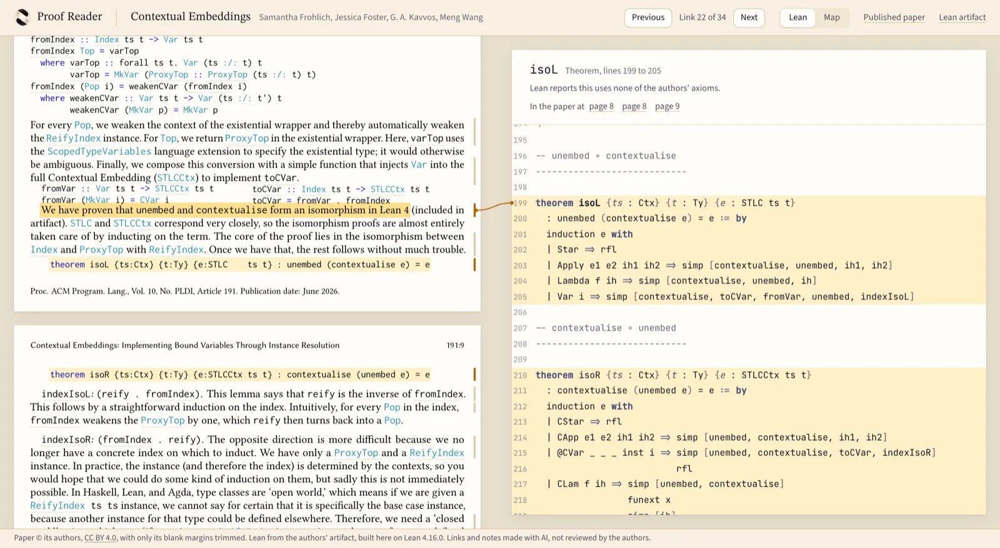

# Proof Reader

[Will Cook’s home page: all projects and videos](https://wcook04.github.io/)

Proof Reader shows a research paper beside its proof in [Lean](https://lean-lang.org),
a language for writing mathematical statements and proofs that a computer can check.
Click a linked sentence in the paper and the Lean code it describes opens beside it, under
a graph of the other declarations that code uses.

**[Open the site](https://wcook04.github.io/proof-reader/)** or go straight to
[one paragraph of *Contextual Embeddings* and the five lines of Lean it describes](https://wcook04.github.io/proof-reader/#/contextual-embeddings/@isoR-clam).

[](https://wcook04.github.io/proof-reader/#/contextual-embeddings)

## Pages on the site

| Page | What it is | Lean by |
| --- | --- | --- |
| [Contextual Embeddings](https://wcook04.github.io/proof-reader/#/contextual-embeddings) | The paper by Frohlich, Foster, Kavvos and Wang (PLDI 2026), set from its PDF under CC BY 4.0 | The paper's authors |
| [Reading the Lean PCP proof](https://wcook04.github.io/proof-reader/#/pcp-reading-guide) | Troy Lee's own guide to his formalization | Troy Lee |
| [The algebraic PCP theorem: a detailed account](https://wcook04.github.io/proof-reader/#/pcp-full-argument) | A detailed account of the algebraic proof of the PCP theorem, following the Lean | Troy Lee |
| [Constant-query verification by algebraic encoding](https://wcook04.github.io/proof-reader/#/pcp-specialist) | A shorter account of the same proof, for specialists | Troy Lee |
| [Checking a long proof by reading a few bits](https://wcook04.github.io/proof-reader/#/pcp-exposition) | The same proof through worked examples that follow one colouring constraint down to the bits the verifier reads | Troy Lee |
| [The minimum of the coupled spring potential](https://wcook04.github.io/proof-reader/#/coupled-spring) | The coupled spring potential U(x₀, x₁) = x₀² + x₀x₁ + x₁² and its minimum at the origin, beside the PhyslibAlpha proof that the origin is a local minimum | Bjørn Kjos-Hanssen |
| [Gauge theory](https://wcook04.github.io/proof-reader/#/physlib-gauge-theory) | Physlib's own API map for gauge theory, beside the Lean files it cites | Physlib contributors |
| [SMT-LIB 2.7 and BSmtLib](https://wcook04.github.io/proof-reader/#/smtlib-2-7) | The SMT-LIB 2.7 standard by Barrett, Fontaine and Tinelli, as its PDF, beside BSmtLib's formalised reading of its syntax. GPT-6.1 found the links without seeing the authors' citations, and a program scored them against those citations ([the evaluation](papers/smtlib-2-7/evaluation/)) | Jan Onderka, Armin Biere and Henrik Böving |
| [Finite-time singularity for the Euler equations](https://wcook04.github.io/proof-reader/#/euler) | The arXiv version of the paper by Alpöge, Buckmaster and Coiculescu, set from their TeX, beside their Lean: 972 sentence ties, a comparison of each of the 42 numbered results with its Lean, and a title and note on every declaration. Their paper thanks Anthropic for supporting the collaboration; hosted with credit to them and [their repository](https://github.com/mcoiculescu/EulerBlowupPublic) | The paper's authors |

The algebraic PCP proof is due to Amireddy, Behera, Srinivasan, Sudan and Willumsgaard.
Will Cook prepared the three PCP accounts with AI assistance, and AI agents wrote the
coupled spring page under his direction.
On every page, the links between sentences and Lean, the plain titles of declarations and
any comparisons of a statement with its Lean were made with AI and have not been reviewed
by the authors of the paper or the Lean.

## Reading a page

The paper is on the left and the proof pane on the right. As you scroll, the proof pane
shows the declaration for the linked passage you are reading. Use the **Graph / Lean**
toggle to choose what stays beside the paper. In Graph mode the reading note comes before
the Lean statement, with the fitted drawing below. What uses the declaration stands on the
left, and what it uses stands on the right. A crowded side gathers nodes into named groups.
Click a group to open it or use **Fit** to fold it again. Pointing at a node previews its
Lean in the dock. **Whole proof map**
swaps the drawing for a map of every declaration. In Lean mode the Lean has the whole pane.
Clicking a sentence or a node keeps its Lean open until you read on to another linked
statement, and **Back** returns to where you were. A click never changes the mode, and
Escape lets go of what was clicked. The divider between the drawing and the dock can be
dragged, and the site remembers where you leave it. On a phone the drawing folds to one
line until you ask for it.

Citations and figures open beneath the paragraph that mentions them. Each linked
statement has its own address, so you can send someone straight to it. The contents
end with an index of the named Lean definitions and theorems (declarations), with the
axioms Lean reports for each. For a PDF paper, the original PDF is one click away.

[What the checks show](docs/what-the-checks-show.md) says what the build programs test on
each page. No program tests whether a sentence means the same as its Lean.

In the Gauge theory guide, **Auto** follows the guide as you scroll and **Manual** holds the
selected citation. Select a highlighted phrase to open the matching Lean declaration. The
dependency map at the end shows how Gauge theory connects to other Physlib API maps.

## Run it locally

You need Python 3.11 or later, Node 20.19 or later and
[Poppler](https://poppler.freedesktop.org/) (`brew install poppler` on macOS,
`sudo apt-get install poppler-utils` on Ubuntu).

```sh
git clone https://github.com/wcook04/proof-reader.git
cd proof-reader
npm ci --prefix web
python3 tools/paper.py build
cd web && npm run dev
```

Open the address it prints. `paper.py build` makes the site's data from the files in
`papers/` and `api-maps/`, including the recorded Lean output, so reading the existing
pages does not need Lean installed. Run it again after changing a paper's files.

For a static copy, run `npm run build` in `web/`; it writes `web/dist/`, and
`npm run preview` serves it. Use the same `VITE_BASE_PATH` for both, for example
`VITE_BASE_PATH=/proof-reader/`.

## Add a paper

A paper is one folder under `papers/`, holding the paper, the authors' Lean project and a
`links.json` that ties passages of the paper to Lean declarations. The paper can be a PDF,
with a reading copy that `tools/transcribe.py` drafts from it, or a Markdown file.

- [The paper folder](docs/paper-folder.md) lists every file and command.
- [The add-paper guide](skills/add-paper/SKILL.md) is the step-by-step procedure, written
  so that a person or an AI assistant can follow it.
- [Contributing](CONTRIBUTING.md) covers licences, reporting a wrong link and changing the code.

## Repository layout

Data moves one way: the files in `papers/` and `api-maps/` go through `tools/paper.py`
into `web/public/`, and the website in `web/` reads them. The generated folders
`web/public/papers/`, `web/public/api-maps/` and `web/dist/` are ignored by Git.

| Folder | What it contains |
| --- | --- |
| [papers/](papers/) | One folder for each paper: the source, the authors' Lean, links and recorded Lean output |
| [api-maps/](api-maps/) | Physlib's Gauge theory API map, the Lean it cites, and our plain titles |
| [docs/](docs/) | The paper folder reference, what the checks show, and the `paper.toml` template |
| [skills/add-paper/](skills/add-paper/) | The step-by-step guide to adding a paper |
| [tools/](tools/) | Python programs that extract the Lean, draft and compare reading copies, and build the data |
| [web/](web/) | The website, written in React and TypeScript |
| [web/src/map/](web/src/map/) | The whole proof map, copied from [Lean Exposition](https://github.com/wcook04/lean-exposition) |
| [web/src/proof/FocusGraph.tsx](web/src/proof/FocusGraph.tsx) | The drawing around one declaration, shared with the other readers; [docs/graph-pane.md](docs/graph-pane.md) describes it |
| [tests/](tests/) | Python unit tests, [journey.py](tests/journey.py), which drives the site in a browser, and [graph_pane.py](tests/graph_pane.py), which checks the drawing on every paper |
| [.github/workflows/](.github/workflows/) | [pages.yml](.github/workflows/pages.yml) tests every paper, builds the site and publishes it; the others compile a paper's Lean or run Comparator |

Before committing, run the commands in [AGENTS.md](AGENTS.md). `tests/journey.py` needs
Playwright for Python and a site built with `VITE_BASE_PATH=/proof-reader/`.

## Related work and videos

[Introduction to the projects](https://www.youtube.com/watch?v=FwgaZYH2otY) · [Proof Reader short](https://www.youtube.com/watch?v=LZxaDZ-gQm8) · [Full comparison of the three maths readers](https://www.youtube.com/watch?v=ZE9thkr5jew)

[Lean Exposition](https://github.com/wcook04/lean-exposition) contains writing guides and
tools for explaining a Lean proof in three papers at different levels of detail. Its
[reading website](https://wcook04.github.io/lean-exposition-site/) shows those draft
explanations beside the graph, and [this video goes through that site](https://www.youtube.com/watch?v=sYMDcT7vyng).

## Licence

The code is Apache-2.0; see [LICENSE](LICENSE) and [NOTICE](NOTICE). Each paper and Lean
project keeps its own licence and credit, named in its `paper.toml` or folder and on its page.

Proof Reader is one of Will Cook's sites. The other websites and code are on
[Will's home page](https://wcook04.github.io/), with the [project videos](https://wcook04.github.io/#videos).
