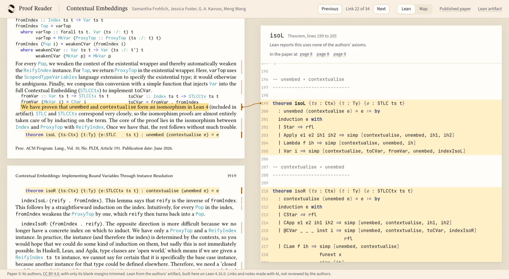

# Proof Reader

Proof Reader lets you read a paper as you read any paper, with its Lean proof coming along
beside it. The paper is the left page, set for reading on a screen. The right page is a graph of
the proof that follows you as you scroll, and any marked statement opens into the authors' own
Lean, so nobody has to hunt through an artifact to find what a paper proved.



- Read the paper. The statement under the reading line takes the highlighter and its card
  lights on the graph, named in plain words.
- Click a statement or a highlighted card and it opens into the raw Lean at the exact lines,
  under a band of graph. "isoR's CLam case" lands on `CLam`'s five lines, not on the top of
  `isoR`. Escape or Back gives you the graph exactly as it was.
- Leave the Lean open and it follows too, level with the sentence you are reading. A short line
  crosses the gutter between them.
- Citations and figures open under the paragraph that mentions them, so you keep your place.
- Back works from anything, and returns the same pixel of the paper, the same pin and the same
  graph, after a reload as well. Every sentence and declaration has an address to send someone.
- At the back of the book: an index of every declaration, with its axioms as Lean reports them.

It writes no explanation of its own. The reading copy is checked against the PDF by a
program, word for word, and the PDF is one click away. The map and axiom facts come from
Lean. The only added words are a short plain title for each declaration, and short notes
where the paper and the Lean differ, each tied to the passage it rests on.

## Add a paper

A paper is a folder. Everything else is generated from it.

```
papers/<slug>/
  paper.pdf      the authors' PDF, unchanged
  paper.md       the paper's text, checked against the PDF word for word
  paper.toml     title, authors, licences and the Lean modules to read
  lean/          the authors' Lean project, unchanged
  links.json     which passage goes with which declaration, and each one's plain title
  generated/     what Lean reports about the project
```

The [add-paper skill](skills/add-paper/SKILL.md) walks an agent or a person through
it. In short:

```sh
python3 tools/paper.py new my-paper       # then add the PDF, Lean and paper.toml
python3 tools/paper.py extract my-paper   # build the Lean and list its declarations
python3 tools/transcribe.py my-paper      # draft paper.md from the PDF's structure
python3 tools/paper.py check my-paper     # every word, quote and name must hold
python3 tools/paper.py build              # write the data the site reads
```

`extract` needs [elan](https://github.com/leanprover/elan) and runs the authors' Lean
on the toolchain they pinned. `check` and `build` need Python 3.11 and Poppler, and, for
a paper with a `paper.md`, Node with `npm install` run in `web/`. `transcribe.py` also
needs `pypdf`. The authors' code runs on your machine, so read a project you do not
trust before extracting it.

## Run the site

```sh
cd web
npm install
npm run dev
```

Open the address it prints. `npm run build` writes a static site to `web/dist`; set
`VITE_BASE_PATH` to the folder it will be served from.

To walk a reader's whole visit in a real browser, build for the public path and run the
journey. It needs Playwright for Python, and takes `--browser firefox` or `webkit` as well:

```sh
cd web && VITE_BASE_PATH=/proof-reader/ npm run build && cd ..
python tests/journey.py --shots /tmp/journey
```

`tools/capture_images.py` retakes the social card and the picture above from a running site.

## What the checks mean

`check` compares every word of the reading copy with the PDF, and a single changed
word stops the build. Only a word split by a line end, and a block moved from where
the page put it, such as a footnote, are let through. So it says the words are the same.
It does not say every word is in its right place inside a moved block, and words inside
plots are skipped because the plots are cut from the PDF itself. It also confirms that
every quotation appears exactly once, that exact Lean lines lie inside their declaration
and that every name is real. It cannot confirm that a passage is about the code it
points to; that takes reading both. Names printed in the paper are linked by matching
the name alone, so a paper's Haskell `STLC` opens the Lean `STLC`. Lean's report says
what a proof depends on, and says nothing about whether a statement means what the
paper says. The links and notes on a page are unreviewed until an author says
otherwise, and each page says so.

## Repository map

| Path | What it holds |
| --- | --- |
| `papers/` | One folder for each paper |
| `skills/add-paper/` | How to fill in a new paper |
| `tools/paper.py` | Extract, check and build |
| `tools/transcribe.py` | Draft a paper's reading text from its PDF |
| `tools/reading.py` | Compare the reading copy with the PDF and mark its ties |
| `web/tools/render-paper.mjs` | Typeset `paper.md` with Markdown and KaTeX |
| `tools/extract.lean.template` | The Lean program that lists a project's declarations |
| `web/` | The website |
| `web/src/map/` | The map, copied from [lean-exposition](https://github.com/wcook04/lean-exposition) |
| `web/src/app/history.ts` | What one history entry remembers |
| `web/src/proof/` | The right page: graph, Lean, handle |
| `tests/journey.py` | A reader's whole visit, in a real browser |

## Licence

Code is Apache-2.0; see [LICENSE](LICENSE) and [NOTICE](NOTICE). Each paper and Lean
project keeps its own licence and credit, named in its `paper.toml` and on its page.
